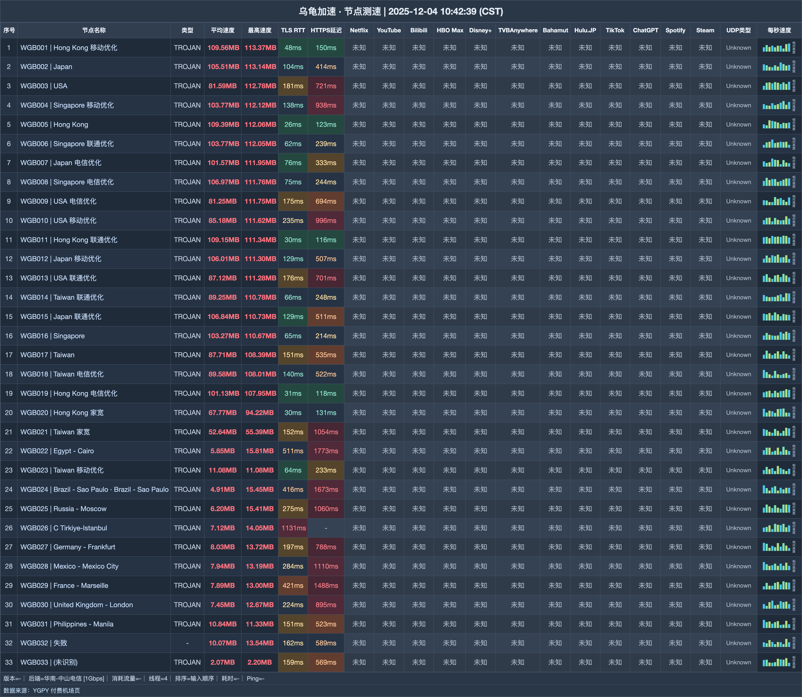

# 乌龟加速机场｜18 元 200G 起，家庭月付不限设备（2026-11-06 更新）

> **一句话结论：四档月付从 200G 覆盖到 1200G，家庭共享还附带 EMBY**
>
> 👉 **[官网注册](https://wuguijiasu.com/#/login?code=dd6NtGYo)** · 先试 18 元 Mini；家庭多人高频使用再换 38 元 Pro。

### 这些家庭更合适：

- 希望 18 元就有 200G 起步流量
- 家中设备和成员都比较多
- 可以使用官方专属客户端

### 这两类需求会冲突：

- 坚持只用非官方客户端
- 不需要家庭共享，也不会使用 EMBY

| 选购项 | 结论 |
|---|---|
| 最低月付 | 18 元 / 200G |
| 月付容量 | 200G—1200G |
| 速度档位 | 300—1000Mbps |
| 月付设备 | 不限，限家庭共享 |
| 线路 | IEPL |
| 客户端 | 必须使用官方专属客户端 |

**认识一下这家机场**：乌龟加速（wuguijiasu）从 18 元 200G 起售，月付档走 IEPL、支持家庭共享并赠送 EMBY，但必须使用官方专属客户端。

## 全部套餐怎么卖

| 套餐名称 | 费用 | 流量与周期 | 设备数 | 速度 | 购买须知 |
|---|---:|---:|---:|---:|---|
| Mini-包月200G | ¥18/月付 | 200G / 每月 | 不限 | 300M | 可购买重置包，家庭共享，赠送EMBY |
| Pro-包月500G | ¥38/月付 | 500G / 每月 | 不限 | 500M | 可购买重置包，家庭共享，赠送EMBY |
| Max-包月800G | ¥58/月付 | 800G / 每月 | 不限 | 800M | 可购买重置包，家庭共享，赠送EMBY |
| Star-包月1200G | ¥78/月付 | 1200G / 每月 | 不限 | 1000M | 可购买重置包，家庭共享，赠送EMBY |
| Max-不限时3000G | ¥358/一次性 | 3000G / 用完为止 | 不限 | 1000M | 可购买重置包，家庭共享 |
| Star-不限时6000G | ¥658/一次性 | 容量待确认 / 用完为止 | 不限 | 1000M | 标题/括注6000G/6000GB，详情字段658.00GB，与¥658价格疑似串位但未证实 |

> 所有套餐无退款，且须使用官方专属客户端。6000G 档标题写 6000G/6000GB，详情字段却是 658.00GB；价格仍为 ¥658，容量确认前不把它作为推荐档。

## 节点测速一览

测试收录 **33 个节点**，内容覆盖下载与延迟；测试端为 **华南-中山电信 [1Gbps]**，逐行结果放在下图。

## 优先看月付四档

1. 入门直接选 18 元 Mini：200G、300Mbps，先确认客户端支持自己的系统。
2. 家庭需要 500G 时升级 38 元 Pro，对应 500Mbps。
3. 大流量优先选 358 元 3000G 不限时包；6000G 档先不买。

## 从这里注册

👉 **[官网注册](https://wuguijiasu.com/#/login?code=dd6NtGYo)** · 先试 18 元 Mini；家庭多人高频使用再换 38 元 Pro。

*本文含推广链接；通过本文入口注册或购买，本站可能获得佣金。*

## 本文更新记录

- **2026-11-06** — 每日复核：套餐、价格与公告无变化；多账号发布对齐核查完成。
- **2026-11-05** — 每日复核：套餐、价格与公告无变化；多账号发布对齐核查完成。
- **2026-11-04** — 每日复核：套餐、价格与公告无变化；多账号发布对齐核查完成。
- **2026-10-31** — 核对 6 个套餐/展示项，完成价量与限制整理。
- **2025-12-04** — 生成 B 版节点测速图，共 33 行。

---
*套餐、节点和活动可能调整，最终以购买页为准。*

展开相关搜索词

相关关键词：乌龟加速、乌龟、wugui、乌龟机场、wuguijiasu、机场推荐、机场测评、机场推荐2026、科学上网、代理、VPN、clash 订阅、乌龟加速官网、乌龟加速注册、乌龟加速测速

